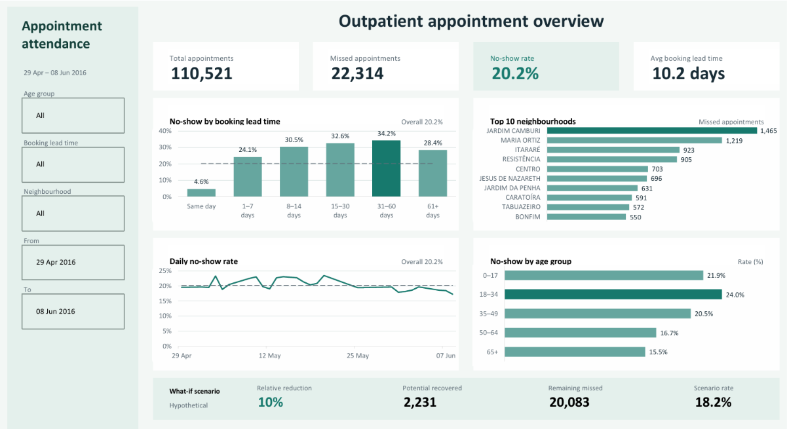

# Medical Appointment No-Show Analysis

SQL Server and Excel analysis of appointment attendance, booking lead time, age groups, and neighbourhoods.

## Overview

This project uses SQL Server for data preparation and analysis and Excel for an interactive dashboard. The business goal is to identify where missed appointments are concentrated and suggest scheduling improvements to test.

The source contains **110,527 appointments and 14 columns** from Brazil. Appointment dates span **April 29 to June 8, 2016**. Each row represents an appointment; a patient can have multiple appointments.

## Dashboard

[Download the Excel workbook](Excel/Hospital_Appointments_Dashboard_B.xlsx)

The dashboard includes appointment KPIs, booking lead-time and age-group comparisons, neighbourhood rankings, a daily no-show trend, and a what-if scenario. Filters cover age group, booking lead time, neighbourhood, and appointment dates.

## Business Questions

- What is the overall no-show rate?
- How do attendance patterns vary by booking lead time, age group, and neighbourhood?
- How does the no-show rate vary across observed appointment dates?
- What would a hypothetical reduction in no-shows represent in appointment counts?

Additional SQL queries examine weekdays, SMS status, and repeat no-shows within the sample.

## Data Preparation

The workflow preserves the Raw table, validates important fields, and creates a Clean table and analysis view.

- Check appointment ID uniqueness, missing values, and field validity.
- Convert dates and numeric fields to appropriate types while retaining IDs as text.
- Exclude **one appointment with a negative age** and **five appointments dated before booking**.
- Map `NoShowFlag`: **1 = missed; 0 = attended**.
- Calculate calendar-day booking lead time and create age and lead-time groups.

The resulting analysis dataset contains **110,521 appointments**. The no-show rate is missed appointments divided by all appointments in the same filter scope.

## Results

| Metric | Result |
|---|---:|
| Appointments | 110,521 |
| Missed appointments | 22,314 |
| No-show rate | 20.2% |
| Average booking lead time | 10.2 days |

- **Lead time:** 31-60 days had the highest no-show rate (**34.2%**), compared with **4.6%** for same-day bookings. The 1-7 day group had the largest missed count (**7,772**). Rates did not increase consistently across every lead-time band.
- **Age:** Appointments for patients aged 18-34 had the highest rate among the defined groups (**24.0%**); the 65+ group had the lowest (**15.5%**).
- **Neighbourhood:** Jardim Camburi had the largest missed count (**1,465**), although its rate was approximately **19.0%**, below the overall rate. High volume does not necessarily mean a high rate.

## Recommended Action and Scenario

Test a limited pilot of appointment confirmation, early cancellation, and rescheduling. Prioritize follow-up using both missed counts and rates. Evaluate attendance, slots actually refilled, and follow-up workload against a suitable comparison group.

A **10% relative reduction** in missed appointments would represent approximately **2,231 potentially recovered appointments**, **20,083 remaining no-shows**, and an **18.2% scenario rate**, holding total appointments constant. This is an assumption, not an achieved improvement or validated forecast.

## Limitations

The historical Brazilian sample does not establish causation or directly represent current hospital performance elsewhere. The data does not establish reasons for absence, financial losses, or available hospital capacity.

## How to Use

1. Download the [source CSV from Kaggle](https://www.kaggle.com/joniarroba/noshowappointments). The source lists the license as **CC BY-NC-SA 4.0**; credit Joni Hoppen and Aquarela Analytics.
2. Create a SQL Server database named `Hospital_Analytics`.
3. Import the CSV into `dbo.MedicalAppointments_Raw`, preserving source column names and IDs as text. Raw text columns and UTF-8 import preserve the original values for conversion in SQL.
4. Run [Hospital_Appointments.sql](SQL/Hospital_Appointments.sql) in SSMS, reviewing data-quality results before loading Clean data.
5. Open the Excel workbook and select the `Dashboard` sheet.

The SQL script creates Clean only when absent; subsequent runs reuse it. Updating the CSV alone does not reload Raw or Clean. The workbook contains loaded data. SQL refresh requires a working local connection configured for the recipient's server; it reads the analysis view rather than rerunning the cleaning script.

## Files

- `SQL/Hospital_Appointments.sql`: preparation and analysis queries.
- `Excel/Hospital_Appointments_Dashboard_B.xlsx`: editable workbook.
- `images/dashboard.png`: dashboard preview.
